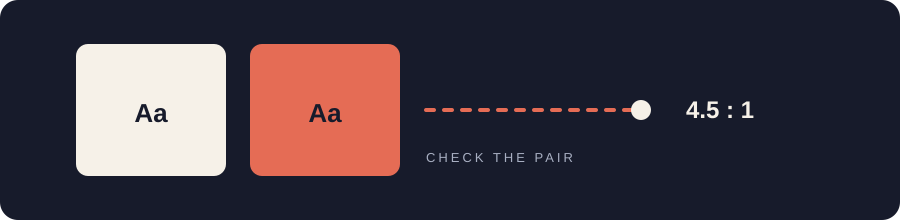

# Contrast Canvas

A calm, browser-only workbench for checking foreground/background contrast before a color reaches production.



## What it does
- Calculates WCAG 2.2 contrast ratios for opaque sRGB hex colors.
- Checks normal-text AA/AAA and large-text AA/AAA thresholds.
- Previews the selected pair in realistic text samples.
- Exports CSS custom properties; colors never leave your browser.

## Run it
No build step or dependencies. Open `index.html`, or serve the folder:

```bash
python -m http.server 8000
# visit http://localhost:8000
```

## Verify
Node.js 18+ is only needed for the tests:

```bash
node --test tests.mjs
```

## Scope
Accepts 3- or 6-digit hex colors and calculates standard sRGB relative luminance. It does not simulate display calibration, transparency, gradients, or text rendered as images. A passing ratio is one accessibility check, not a complete audit.

## Design & motion
The original ink-and-coral illustration is decorative and respects reduced-motion preferences. The interface remains usable without animation.

## Contributing
Open an issue with a reproducible example. Keep calculations pure, add edge-case tests, and preserve keyboard access.

## License
MIT. See [LICENSE](LICENSE).
